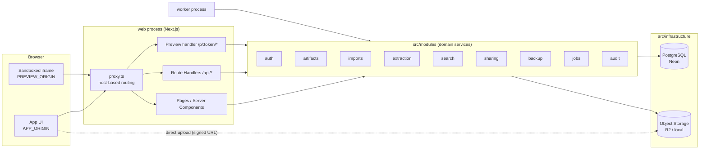
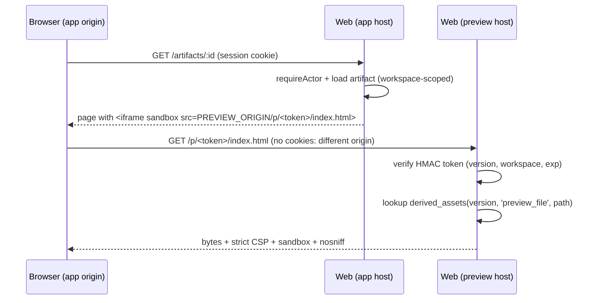
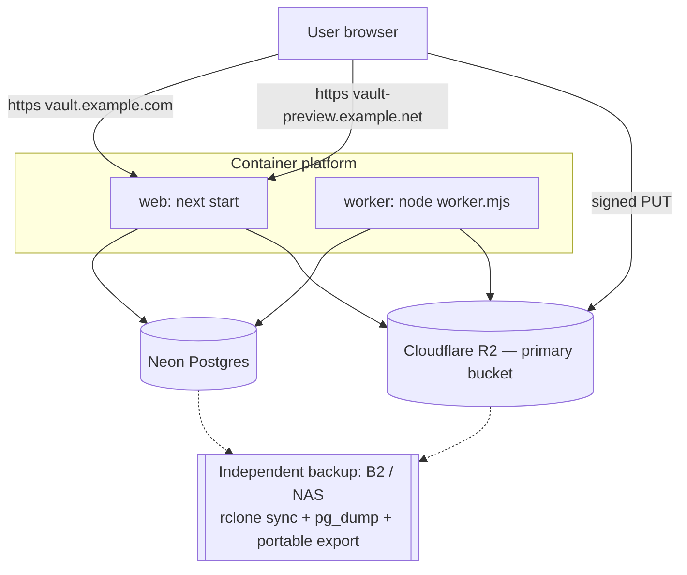

# Architecture

## 1. Overview

AI Knowledge Vault is a **modular monolith**. One codebase produces two processes:

| Process  | Entry                                         | Role                                                                                              |
| -------- | --------------------------------------------- | ------------------------------------------------------------------------------------------------- |
| `web`    | `next start` (Next.js 16 App Router)          | UI (Server Components), REST route handlers, auth, preview origin                                 |
| `worker` | `node dist/worker.mjs` (`src/worker/main.ts`) | Durable background jobs: import, extraction, indexing, export, restore, integrity checks, cleanup |

Both share `src/modules/*` (domain) and `src/infrastructure/*` (adapters).



## 2. Layering and dependency rules

```
src/app/**            (Next.js adapters: pages, route handlers)   ──▶ modules, lib, components
src/components/**     (React UI; client or server)                ──▶ lib, types   (never modules/infrastructure)
src/modules/<m>/**    (domain services + repositories)            ──▶ infrastructure, lib, other modules' public index.ts
src/infrastructure/** (db client & schema, storage, logger, config) ──▶ lib
src/lib/**            (pure helpers: ids, hashing, errors, i18n)   ──▶ nothing app-specific
src/worker/**         (job runtime entry)                          ──▶ modules, infrastructure
```

Enforced rules:

1. **UI never touches the database or storage.** `src/components/**` cannot import
   `@/infrastructure/*` or `@/modules/*`. This is an ESLint `no-restricted-imports` rule.
   Pages (Server Components) call module services, which return plain DTOs.
2. **Modules never import Next.js.** `next/*` is banned in `src/modules/**` and
   `src/infrastructure/**`, so they run unchanged in the worker and in tests.
3. **Modules talk to each other through their `index.ts`**, not deep imports. The
   exception is shared schema types from `@/infrastructure/database/schema`.
4. **Every service function that reads or writes user data takes an `Actor`** and scopes
   queries by `actor.workspaceId`. System jobs use a `SystemActor` bound to the job's
   workspace.

## 3. Module responsibilities

| Module             | Owns                                                                                                                                                | Phase                 |
| ------------------ | --------------------------------------------------------------------------------------------------------------------------------------------------- | --------------------- |
| `auth`             | Better Auth instance, session → `Actor`, admin bootstrap, login rate limits                                                                         | 1A                    |
| `workspaces`       | Workspaces, membership, role policy (`can()`)                                                                                                       | 1A                    |
| `audit`            | Append-only `audit_logs`; `recordAudit()`                                                                                                           | 0                     |
| `jobs`             | `processing_jobs` queue: enqueue (transactional), claim, heartbeat, retry/backoff, lease recovery, handler registry, worker loop                    | 0                     |
| `files`            | `file_assets`: immutable original storage, SHA-256, integrity verification, download authorization                                                  | 1A                    |
| `imports`          | `import_batches`/`import_items`, upload authorization, the item state machine, the import pipeline orchestration, the batch report, staging cleanup | 1A                    |
| `extraction`       | Format detection (magic bytes), ZIP inspection and safe extraction, HTML/MD/TXT/PDF extractors, normalization, sections, preview classification     | 1A                    |
| `artifacts`        | Research projects, artifacts, versions, artifact files, derived assets, source metadata, version matching, soft delete                              | 1A                    |
| `preview`          | Preview token signing and verification, preview file serving policy, CSP                                                                            | 1B                    |
| `library`          | Collections, tags, notes, reading state, favorites                                                                                                  | 1B                    |
| `search`           | CJK-aware tokenizer, chunking, indexing, permission-filtered query, snippets                                                                        | 1B                    |
| `sharing`          | Share links, public/unlisted access resolution, pre-share safety scan                                                                               | 1B                    |
| `backup`           | Export archive writer, manifest/checksums, restore reader, ID mapping, restore report, integrity check runs                                         | 1A                    |
| `ai` / `knowledge` | Provider adapters, RAG, claims, topics, gaps                                                                                                        | 2–3 (not created yet) |

## 4. Key data flows

### 4.1 Import (asynchronous)

```mermaid
sequenceDiagram
  participant B as Browser
  participant A as API (web)
  participant S as Storage
  participant D as Postgres
  participant W as Worker
  B->>A: POST /api/imports {projectId?, collectionId?}
  A->>D: insert import_batches
  B->>A: POST /api/imports/:batch/items {filename, size, mime, clientKey}
  A->>A: validate name/size/type (Zod + limits)
  A->>D: insert import_items(status=awaiting_upload)
  A->>S: createSignedUploadUrl(staging key, size, ttl=15m)
  A-->>B: {itemId, uploadUrl}
  B->>S: PUT bytes (direct)
  B->>A: POST /api/imports/:batch/items/:item/complete
  A->>S: headObject(staging) — size check
  A->>D: tx{ item.status=queued; insert processing_jobs(import.process_item, key=import_item:<id>) }
  W->>D: claim job (SKIP LOCKED, lease)
  W->>S: stream staging object → SHA-256 + magic-byte sniff + limits
  W->>D: lookup file_assets(workspace, sha256)
  alt duplicate hash
    W->>D: item.status=duplicate → existing artifact/version
  else new content
    W->>S: put originals/<sha256> (if-none-match)
    W->>W: classify + extract (ZIP safe walk / HTML / PDF / MD / TXT / image)
    W->>S: put derived preview files + thumbnail
    W->>D: tx{ file_asset, artifact|version, artifact_files, derived_assets, extracted_document, sections, item.status=succeeded }
  end
  W->>S: delete staging object
  B->>A: GET /api/imports/:batch (poll) → report
```

Failure handling:

- Every step is idempotent, keyed by `import_item.id` and the content hash.
- A crash at any point leaves the job's lease to expire. Recovery re-queues the job, and a
  re-run either finds the already-committed result (no-op) or redoes uncommitted work.
- Storage writes are content-addressed, so a re-run writes the same key.
- The database write of artifact, version and files happens in one transaction.

### 4.2 Reading and preview



Reading mode renders `extracted_documents.normalized_markdown` through a safe Markdown
renderer that emits no raw HTML. It runs on the app origin.

### 4.3 Search (Phase 1B)

`query → tokenize (same tokenizer as indexing) → tsquery → content_chunks ∪ artifact_search_documents
WHERE workspace_id = actor.workspace AND artifact not deleted → rank → group by artifact → snippet + highlight`

### 4.4 Backup and restore

```
Export job: read workspace rows → write metadata/*.json → stream originals → normalized/*.md
            → checksums.sha256 → manifest.json → upload ZIP to storage (exports/) → export_runs row
Restore job: upload archive → verify structure + format version → verify every checksum
            → restore originals (content-addressed, dedup) → upsert rows with ID mapping
            → enqueue re-extraction/indexing → restore report
```

### 4.5 AI research (Phase 2, designed only)

`User query → permission filter → retrieval (hybrid) → evidence assembly (budgeted) → provider adapter → citation verification → answer with sources + limits`.
See `AI_RESEARCH.md`.

## 5. Deployment topology (target)



See `DEPLOYMENT.md` for environments, secrets, and the migration workflow.

## 6. Cross-cutting concerns

- **Configuration:** `src/infrastructure/config/env.ts` validates every variable with Zod on
  first use. It fails fast, and its error messages never echo secret values.
- **Errors:** Domain code throws `AppError(code, httpStatus, safeMessage, details)`. Route
  handlers map errors to `{ error: { code, message, errorId, details? } }`. Unexpected
  errors are logged with an `errorId`; the client sees only the id.
- **Logging:** Pino JSON logs. Redaction covers `password`, `token`, `secret`,
  `authorization`, `cookie`, `apiKey` and storage credentials. Logs never contain document
  bodies.
- **Audit:** Security-relevant events (login, export, restore, share create/revoke,
  visibility change, delete, download of originals) go to `audit_logs`.
- **Time:** All timestamps are `timestamptz` in UTC. The UI renders `Asia/Taipei` by
  default.
- **IDs:** UUIDv7 everywhere (ADR-008).

## 7. Failure handling matrix

| Failure                                                | Behaviour                                                                                                                                 |
| ------------------------------------------------------ | ----------------------------------------------------------------------------------------------------------------------------------------- |
| Worker crash mid-job                                   | Lease expires (default 120 s) → recovery sets `queued`, `attempt_count` preserved → re-run is idempotent                                  |
| Job throws a retryable error                           | `run_after = now + backoff(attempt)`; after `max_attempts` → `failed` with `error_code`/`last_error`                                      |
| Job throws a permanent error (validation, unsupported) | `failed` immediately; the import item shows the reason                                                                                    |
| Upload never completed                                 | Item stays `awaiting_upload`; the cleanup job expires it after `upload_expires_at` and deletes any staging object                         |
| Staging object exists but DB never advanced            | Cleanup job reconciles: items in `uploaded`/`awaiting_upload` with an existing object can be completed by the user (retry) or are expired |
| Original stored but DB transaction failed              | Object is content-addressed. The retry reuses it, and the orphan scan (`integrity` job) reports objects without `file_assets` rows        |
| DB row exists but object missing                       | Integrity check marks `storage_status = missing`, surfaces it in the UI, and restore from backup is required                              |
| Storage unavailable                                    | Upload URL creation returns 503 `STORAGE_UNAVAILABLE`; jobs retry with backoff                                                            |
| Database unavailable                                   | `/api/health` reports degraded; pages show an error state with an error id                                                                |
