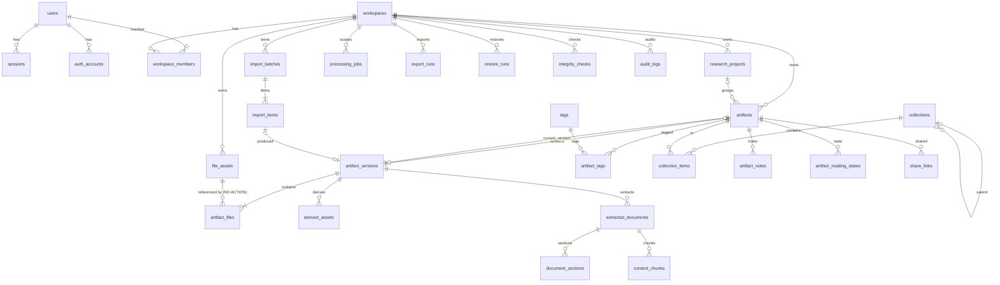

# Data Model

The source of truth for implemented tables is `src/infrastructure/database/schema/*.ts`, plus the
generated SQL in `drizzle/`. This document explains the design, including tables that are planned
but not yet created.

## 1. Design rules

1. Primary keys are `uuid`, generated in the application as UUIDv7 (ADR-008). Join tables use
   composite primary keys.
2. Every mutable entity has `created_at` and `updated_at` (`timestamptz`, default `now()`).
   `updated_at` is maintained by the application.
3. Every user-data row carries `workspace_id` (FK → `workspaces`, `ON DELETE CASCADE`). This is the
   authorization boundary and the future multi-tenant boundary.
4. Foreign keys are always declared. Delete semantics are explicit: `CASCADE` for owned children,
   `SET NULL` for optional links, and `NO ACTION` for anything that protects originals. NO ACTION
   refuses the delete like RESTRICT does, but is checked at statement end, so workspace cascades
   still work.
5. `file_assets` immutability is enforced by a trigger. `UPDATE` may change only
   `storage_status`, `integrity_verified_at` and `updated_at`.
6. Large binaries never go into Postgres. Extracted text does, since PostgreSQL TOAST compresses it.
7. `jsonb` holds only non-core, extensible metadata (warnings, analysis summaries, options). Any
   relationship that is queried or used for authorization is a real column.
8. Text columns are `text` and UTF-8, and the schema is language-agnostic. The content language is
   stored on `extracted_documents.language`.
9. Enumerations use Postgres `text` plus a `CHECK` constraint rather than native enums, so adding
   a value is a simple migration.
10. Adding AI models or providers never changes `artifacts`/`artifact_versions`. AI data lives in
    separate tables keyed by version or chunk.

## 2. Spec table list → implemented names

| Spec name                                                                                   | Implemented as                                                                              | Notes                                                                                       |
| ------------------------------------------------------------------------------------------- | ------------------------------------------------------------------------------------------- | ------------------------------------------------------------------------------------------- |
| users, sessions                                                                             | `users`, `sessions`, `auth_accounts`, `auth_verifications`, `auth_rate_limits`              | Better Auth models mapped to our names                                                      |
| workspaces, workspace_members                                                               | same                                                                                        |                                                                                             |
| share_links                                                                                 | same                                                                                        | Phase 1B                                                                                    |
| audit_logs                                                                                  | same                                                                                        |                                                                                             |
| research_projects, artifacts, artifact_versions, file_assets, artifact_files                | same                                                                                        |                                                                                             |
| —                                                                                           | `derived_assets`                                                                            | new; holds regenerable preview files and thumbnails, kept separate from immutable originals |
| collections, collection_items, tags, artifact_tags, artifact_notes, artifact_reading_states | same                                                                                        | Phase 1B                                                                                    |
| import_sources                                                                              | merged into version source metadata (`source_platform`, …)                                  | revisit when per-account import sources exist                                               |
| import_batches, import_items, processing_jobs                                               | same                                                                                        |                                                                                             |
| extracted_documents, document_sections, content_chunks                                      | same                                                                                        | `content_chunks` carries `search_vector` (Phase 1B)                                         |
| extraction_errors                                                                           | `extracted_documents.status/error_code/error_message/warnings` + `import_items.error_*`     | a separate table added no queryable value                                                   |
| —                                                                                           | `artifact_search_documents`                                                                 | new; artifact-level metadata search vector (Phase 1B)                                       |
| —                                                                                           | `search_index_states`                                                                       | new; what each version's chunks were built from (Phase 1B)                                  |
| embedding_records … research_suggestions                                                    | planned (Phase 2–3)                                                                         | see §5                                                                                      |
| ai_* , prompt_templates                                                                     | planned (Phase 2)                                                                           |                                                                                             |
| backup_runs, export_jobs                                                                    | `export_runs`, `restore_runs`                                                               | Phase 1A                                                                                    |
| backup_manifests                                                                            | the manifest is stored inside the archive; a summary goes in `export_runs.manifest_summary` |                                                                                             |
| integrity_checks                                                                            | same                                                                                        | Phase 1A                                                                                    |

## 3. ERD (Phase 0–1B)



## 4. Tables

Legend: **P** = phase created. `→` = FK. Defaults are shown in parentheses.

### 4.1 Identity & access

**users** (P0) — Better Auth `user`
`id uuid pk`, `name text`, `email text unique` (stored lower-case), `email_verified bool (false)`,
`image text?`, `created_at`, `updated_at`.

**sessions** (P0) — Better Auth `session`
`id`, `token text unique`, `user_id → users CASCADE`, `expires_at`, `ip_address?`, `user_agent?`,
`created_at`, `updated_at`. Index: `user_id`.

**auth_accounts** (P0) — Better Auth `account`. Holds the scrypt password hash for the credential
provider. `id`, `account_id`, `provider_id`, `user_id → users CASCADE`, `access_token?`,
`refresh_token?`, `id_token?`, `access_token_expires_at?`, `refresh_token_expires_at?`, `scope?`,
`password?`, timestamps.

**auth_verifications** (P0): `id`, `identifier`, `value`, `expires_at`, timestamps.

**auth_rate_limits** (P0): `id`, `key text unique`, `count int`, `last_request bigint` (epoch ms).

**workspaces** (P0): `id`, `name`, `slug unique`, timestamps.

**workspace_members** (P0): `pk(workspace_id, user_id)`, `role ∈ {owner, editor, viewer}`,
`created_at`.

**audit_logs** (P0): `id`, `workspace_id? → workspaces CASCADE`, `actor_user_id? → users SET NULL`,
`action text` (for example `auth.login.succeeded`, `artifact.original.downloaded`),
`target_type?`, `target_id?`, `ip_address?`, `user_agent?`, `metadata jsonb ({})`, `created_at`.
Index: `(workspace_id, created_at desc)`, `(action, created_at desc)`.
Append-only: the application never updates or deletes these rows.

**share_links** (P1B): `id`, `workspace_id`, `artifact_id → artifacts CASCADE`,
`token_hash char(64) unique`, `label?`, `allow_preview bool (true)`, `allow_reading bool (true)`,
`allow_download bool (false)`, `expires_at?`, `revoked_at?`, `created_by → users SET NULL`,
`last_accessed_at?`, `access_count int (0)`, `created_at`, `updated_at`.

### 4.2 Library core

**research_projects** (P1A): `id`, `workspace_id`, `title`, `description?`,
`status ∈ {active, archived} (active)`, `created_by?`, timestamps, `deleted_at?`.
Index: `(workspace_id, title)`. Managed since PR 14 (`src/modules/projects`): titles are 1–200
characters, descriptions up to 2,000. Archived projects stay listed but leave the pickers.
Deleting is soft: the project disappears from lists, pickers and filters, while artifacts
keep `project_id` (nothing is lost; an undo stays possible) and show no project.

**artifacts** (P1A)

| column                 | type                                                    | notes                                                                |
| ---------------------- | ------------------------------------------------------- | -------------------------------------------------------------------- |
| id                     | uuid pk                                                 |                                                                      |
| workspace_id           | uuid → workspaces                                       |                                                                      |
| project_id             | uuid? → research_projects SET NULL                      |                                                                      |
| title                  | text                                                    | from extraction, editable                                            |
| description            | text?                                                   | user-provided                                                        |
| summary                | text?                                                   | extractive summary (first paragraph); AI summaries live elsewhere    |
| visibility             | text check ∈ {private, unlisted, public}                | default `private` (P-4)                                              |
| sensitivity            | text check ∈ {normal, sensitive, restricted}            | default `normal`; independent of visibility                          |
| review_status          | text check ∈ {unreviewed, reviewed, verified, disputed} | default `unreviewed`                                                 |
| identity_key           | text?                                                   | normalized distinctive filename stem used for version matching       |
| current_version_id     | uuid? → artifact_versions SET NULL                      | circular FK (declared after both tables)                             |
| origin_ref             | text?                                                   | provenance for restored items, e.g. `export:<exportId>:<originalId>` |
| metadata               | jsonb ({})                                              | non-core extension metadata                                          |
| created_by             | uuid? → users SET NULL                                  |                                                                      |
| created_at, updated_at | timestamptz                                             |                                                                      |
| deleted_at             | timestamptz?                                            | soft delete (ADR-017)                                                |

Indexes:

- `(workspace_id, deleted_at, created_at desc)` for library listing
- `(workspace_id, identity_key)` for version matching
- `(workspace_id, project_id)`

**artifact_versions** (P1A)

| column                 | type                                               | notes                                                                                                                                         |
| ---------------------- | -------------------------------------------------- | --------------------------------------------------------------------------------------------------------------------------------------------- |
| id                     | uuid pk                                            |                                                                                                                                               |
| workspace_id           | uuid                                               |                                                                                                                                               |
| artifact_id            | uuid → artifacts CASCADE                           |                                                                                                                                               |
| version_number         | int                                                | `unique(artifact_id, version_number)`                                                                                                         |
| primary_file_id        | uuid → file_assets NO ACTION                       | the original uploaded file (ZIP, HTML, PDF …)                                                                                                 |
| content_kind           | text check                                         | `html_document`, `claude_design_document`, `static_site`, `framework_project`, `pdf`, `markdown`, `text`, `image`, `archive_other`, `unknown` |
| preview_kind           | text check                                         | `static_html` (A), `static_site` (B), `framework_source` (C), `unsupported` (D), `pdf`, `image`, `text_only`                                  |
| preview_status         | text check ∈ {pending, ready, unavailable, failed} |                                                                                                                                               |
| preview_entry_path     | text?                                              | e.g. `index.html` inside the derived site                                                                                                     |
| processing_status      | text check ∈ {pending, processing, ready, failed}  |                                                                                                                                               |
| active_extraction_id   | uuid? → extracted_documents SET NULL               | circular FK                                                                                                                                   |
| content_hash           | char(64)?                                          | SHA-256 of normalized plain text (suspected-duplicate detection)                                                                              |
| source_platform        | text?                                              | e.g. `claude_design`; `null` = unknown (never guessed)                                                                                        |
| source_model           | text?                                              | only if stated in the file or given by the user                                                                                               |
| original_prompt        | text?                                              |                                                                                                                                               |
| source_url             | text?                                              |                                                                                                                                               |
| research_date          | date?                                              |                                                                                                                                               |
| author                 | text?                                              |                                                                                                                                               |
| reference_sources      | jsonb ([])                                         | list of `{title?, url}` from the document's own reference list                                                                                |
| change_summary         | text?                                              |                                                                                                                                               |
| analysis               | jsonb ({})                                         | classification details: ZIP inventory summary, external dependencies, warnings                                                                |
| import_item_id         | uuid? → import_items SET NULL                      | provenance                                                                                                                                    |
| created_by             | uuid?                                              |                                                                                                                                               |
| created_at, updated_at |                                                    |                                                                                                                                               |

**file_assets** (P1A) — immutable originals

| column                 | type                                    | notes                                                  |
| ---------------------- | --------------------------------------- | ------------------------------------------------------ |
| id                     | uuid pk                                 |                                                        |
| workspace_id           | uuid                                    |                                                        |
| storage_provider       | text                                    | `local` / `s3`                                         |
| storage_key            | text unique                             | `ws/{ws}/originals/{sha256}`, never exposed to clients |
| original_filename      | text                                    | as uploaded (display and export naming)                |
| mime_type              | text                                    | from content sniffing, not the client claim            |
| byte_size              | bigint                                  | verified server-side                                   |
| sha256                 | char(64)                                | `unique(workspace_id, sha256)` (F-04)                  |
| storage_status         | text check ∈ {stored, missing, corrupt} | mutable                                                |
| integrity_verified_at  | timestamptz?                            | mutable                                                |
| created_by             | uuid?                                   |                                                        |
| created_at, updated_at |                                         |                                                        |

Trigger `file_assets_immutable` raises an exception if `UPDATE` touches any other column.

**artifact_files** (P1A): `id`, `artifact_version_id → artifact_versions CASCADE`,
`file_asset_id → file_assets NO ACTION` (refuses deleting a referenced original but allows
workspace cascades), `role ∈ {original, attachment, cover}`,
`display_name text`, `created_at`. `unique(artifact_version_id, file_asset_id, role)`.

**derived_assets** (P1A): `id`, `workspace_id`, `artifact_version_id → artifact_versions CASCADE`,
`kind ∈ {preview_file, thumbnail}`, `path text` (normalized relative path; `''` for a
thumbnail), `storage_key unique`, `mime_type`, `byte_size bigint`, `sha256 char(64)`,
`generator text`, `generator_version int`, `created_at`.
`unique(artifact_version_id, kind, path)`.

### 4.3 Processing

**import_batches** (P1A): `id`, `workspace_id`, `created_by?`,
`status ∈ {open, processing, completed, completed_with_errors, cancelled}`,
`target_project_id? → research_projects SET NULL`,
`target_collection_id? → collections SET NULL` (applies to new artifacts only), `options jsonb` (`{autoVersionByFilename: true,
sourcePlatform?: string}`), `created_at`, `updated_at`, `completed_at?`.
Counts are computed from items with an aggregate query, never denormalized.

**import_items** (P1A)

| column                                                  | notes                                                                                                             |
| ------------------------------------------------------- | ----------------------------------------------------------------------------------------------------------------- |
| id, workspace_id, batch_id → import_batches CASCADE     |                                                                                                                   |
| client_key text?                                        | `unique(batch_id, client_key)`; makes item declaration idempotent across client retries                           |
| original_filename, declared_size bigint, declared_mime? | client claims, re-verified by the worker                                                                          |
| staging_key text                                        | `ws/{ws}/staging/{itemId}`                                                                                        |
| status                                                  | `awaiting_upload`, `uploaded`, `queued`, `processing`, `succeeded`, `duplicate`, `failed`, `cancelled`, `expired` |
| outcome?                                                | `new_artifact`, `new_version`, `duplicate_file`                                                                   |
| target_artifact_id? → artifacts SET NULL                | explicit "add as new version of"                                                                                  |
| file_asset_id? → file_assets SET NULL                   |                                                                                                                   |
| result_artifact_id?, result_version_id?                 | SET NULL                                                                                                          |
| suspected_duplicate_of? → artifacts SET NULL            | FR-IMP-9                                                                                                          |
| match_reason?                                           | `explicit_target`, `filename_stem`, `same_hash`                                                                   |
| detected_type?                                          | e.g. `zip/static_site`                                                                                            |
| sha256 char(64)?                                        |                                                                                                                   |
| error_code?, error_message?                             | user-safe message; the stack goes to logs under an error id                                                       |
| warnings jsonb ([])                                     |                                                                                                                   |
| upload_expires_at                                       |                                                                                                                   |
| created_at, updated_at, completed_at?                   |                                                                                                                   |

Indexes: `(batch_id, status)`, `(status, upload_expires_at)`.

State machine (enforced in `modules/imports/state.ts`):

```
awaiting_upload ──complete──▶ uploaded ──enqueue──▶ queued ──claim──▶ processing ──▶ succeeded | duplicate | failed
      │                                                                                   │
      └──expire──▶ expired                                         failed ──retry──▶ queued
any non-terminal ──cancel──▶ cancelled
```

**processing_jobs** (P0)

| column                                             | notes                                                                                                        |
| -------------------------------------------------- | ------------------------------------------------------------------------------------------------------------ |
| id, workspace_id?                                  |                                                                                                              |
| type text                                          | e.g. `import.process_item`, `export.create`, `restore.run`, `integrity.check`, `maintenance.cleanup_staging` |
| payload jsonb                                      | small, never document content                                                                                |
| status                                             | `queued`, `running`, `completed`, `failed`, `cancelled`                                                      |
| priority int (0)                                   | higher runs first                                                                                            |
| run_after timestamptz (now)                        | backoff and scheduling                                                                                       |
| attempt_count int (0), max_attempts int (5)        |                                                                                                              |
| locked_by text?, locked_until timestamptz?         | lease                                                                                                        |
| heartbeat_at?                                      |                                                                                                              |
| progress jsonb?                                    | `{current, total, message}`                                                                                  |
| idempotency_key text unique                        |                                                                                                              |
| last_error text?, error_code text?                 |                                                                                                              |
| result jsonb?                                      |                                                                                                              |
| created_at, updated_at, started_at?, completed_at? |                                                                                                              |

Index: partial index `(priority desc, run_after) where status = 'queued'`, and
`(status, locked_until)` for recovery.

**extracted_documents** (P1A): `id`, `workspace_id`,
`artifact_version_id → artifact_versions CASCADE`, `extraction_method` (`html`, `markdown`,
`text`, `pdf`, `image`, `archive`), `extraction_version int`,
`status ∈ {succeeded, partial, failed}`, `title?`, `language?` (BCP-47-ish: `zh-Hant`, `en`,
`und`), `plain_text text`, `normalized_markdown text`, `content_hash char(64)`, `char_count int`,
`warnings jsonb`, `error_code?`, `error_message?`, `extracted_at`, `created_at`.
Index: `(artifact_version_id, created_at desc)`.

**document_sections** (P1A): `id`, `extracted_document_id → CASCADE`, `ordinal int`,
`level int` (1–6; 0 = preamble), `heading text?`, `anchor text`, `char_start int`,
`char_end int`. `unique(extracted_document_id, ordinal)`.

**content_chunks** (P1B): `id`, `workspace_id`, `artifact_id → artifacts CASCADE`,
`artifact_version_id → CASCADE`, `extracted_document_id → CASCADE`,
`section_id? → document_sections SET NULL`, `ordinal`, `text`, `char_start`, `char_end`,
`content_hash`, `tokenizer_version int`, `search_vector tsvector`, `created_at`.
Index: `GIN(search_vector)`, `(workspace_id, artifact_id)`.

**artifact_search_documents** (P1B): `artifact_id pk → CASCADE`, `workspace_id`,
`search_vector tsvector` (title A, tags/description B, notes/source C), `tokenizer_version`,
`updated_at`. Index: GIN.

**search_index_states** (P1B): `artifact_version_id pk → artifact_versions CASCADE`,
`workspace_id`, `extracted_document_id? → extracted_documents SET NULL`, `tokenizer_version`,
`chunk_count`, `indexed_at`. Written with the chunks, in the same transaction, also when a
version has no text. The daily backfill compares it with the version's active extraction
instead of guessing from the text (SEARCH_DESIGN §6).

### 4.4 Organization (P1B)

**tags** (built, PR 13): `id`, `workspace_id`, `name` (display form: NFC, single spaces,
1–50 characters, CHECK), `normalized_name` (NFKC, trimmed, lower-case, collapsed whitespace,
default-ignorable characters and blank glyphs removed), `created_at`, `updated_at`. A name
needs at least one visible character (letter, digit, punctuation or symbol; Hangul fillers,
the Braille blank and other characters that render as nothing do not count) and may not
contain bidirectional embeddings, overrides or isolates. Directional marks (LRM, RLM, ALM)
from pasted right-to-left text are dropped. So a tag can neither look empty, look like
another tag, nor display as something else.
`unique(workspace_id, normalized_name)`, `unique(workspace_id, id)`. (`color` is left out
until a UI uses it.)

**artifact_tags** (built, PR 13): `workspace_id`, `artifact_id`, `tag_id`, `created_at`;
`pk(artifact_id, tag_id)`, index on `tag_id`. Both foreign keys are composite and include the
workspace: `(workspace_id, artifact_id) → artifacts(workspace_id, id)` and
`(workspace_id, tag_id) → tags(workspace_id, id)`, both `ON DELETE CASCADE`. The database
itself refuses a link between an artifact and a tag of different workspaces. (Hence
`unique(workspace_id, id)` on `artifacts` and `tags`.) Tag names are indexed into the
artifact's `artifact_search_documents` row (weight B), so tag changes re-index the affected
artifacts in the same transaction.

**collections** (built, PR 15): `id`, `workspace_id`, `parent_id?`,
`kind ∈ {category, collection}`, `name` (1–100 characters, the same visible-text rules as
titles), `normalized_name` (the identity: NFKC, case-folded, spacing collapsed, invisible
characters removed), `description?` (up to 2,000 characters), `sort_order int` (reserved for
manual ordering; 0 today), timestamps. `unique(workspace_id, parent_id, normalized_name)`
NULLS NOT DISTINCT, so siblings (top-level ones too) never share a name; the same name in
different places is fine. `unique(workspace_id, id)`. The parent key is composite,
`(workspace_id, parent_id) → collections(workspace_id, id)`, without cascade: a parent is in
the same workspace, and one with children cannot be deleted (the app answers 409
`HAS_CHILDREN`). `CHECK (parent_id is distinct from id)`. Cycles and depth (at most 7 levels)
are checked in code under a per-workspace advisory lock, which every change of the tree's
shape takes (create, move, delete, restore), so two concurrent moves cannot close a cycle.
Every recursive walk is also bounded, so a direct database write that broke the tree could
not make a query run forever.

**collection_items** (built, PR 15): `workspace_id`, `collection_id`, `artifact_id`,
`position int` (order added), `added_at`; `pk(collection_id, artifact_id)`, index on
`artifact_id`. Both foreign keys are composite with the workspace, `ON DELETE CASCADE`, as
for `artifact_tags`. Filtering the library by a collection includes its whole subtree.

**artifact_notes**: `id`, `workspace_id`, `artifact_id → CASCADE`,
`artifact_version_id? → SET NULL`, `author_id? → users SET NULL`, `body_markdown`, timestamps.

**artifact_reading_states**: `pk(user_id, artifact_id)`, `status ∈ {unread, reading, read}`,
`is_favorite bool`, `last_opened_at?`, `updated_at`.

### 4.5 Data protection (P1A)

**export_runs** (P1A, migration 0004): `id`, `workspace_id`, `requested_by?`, `filename?`,
`status ∈ {queued, running, completed, failed}`, `format_version int`, `options jsonb`,
`storage_key?`, `byte_size?`, `sha256?`, `manifest_summary jsonb?`, `error_message?`,
`job_id?`, `created_at`, `completed_at?`, `expires_at?`.

**restore_runs** (P1A, migration 0004): `id`, `workspace_id` (target), `requested_by?`, `status`, `error_code?`,
`source_storage_key`, `source_sha256?`, `mode ∈ {skip_existing, copy}`, `report jsonb?`,
`error_message?`, `job_id?`, `created_at`, `completed_at?`.

**integrity_checks** (table in migration 0004; job in P1A-INTEGRITY): `id`, `workspace_id`, `status`, `checked_count`, `ok_count`,
`missing_count`, `corrupt_count`, `report jsonb`, `started_at`, `completed_at?`.

## 5. Planned tables (Phase 2–3), designed but not created

- **embedding_records**: `id`, `chunk_id → content_chunks CASCADE`, `provider`, `model`,
  `model_version`, `dimensions`, `content_hash`, `embedding vector(n)` (pgvector), `created_at`.
  `unique(chunk_id, provider, model, model_version)`. Regenerable; never a source of truth.
- **ai_providers**: configured providers (no secrets; keys come from env or a secret manager),
  capabilities and enabled flag.
- **ai_analysis_runs** / **ai_analysis_results**: one run per (operation, input hash, model).
  Results reference evidence chunk IDs. `status`, `cost_estimate`, `prompt_template_version`.
- **ai_usage_records**: provider, model, input/output tokens, estimated cost, run_id, timestamps.
- **prompt_templates**: versioned templates (id, name, version, body, created_at).
- **knowledge_topics**: `id`, `workspace_id`, `title`, `description`, `parent_topic_id?`,
  `importance` (1–5, user-set), `origin ∈ {user, ai}`, `status ∈ {proposed, confirmed, rejected}`.
- **knowledge_edges**: `from_type/from_id`, `to_type/to_id` (topic, artifact, claim),
  `relation ∈ {related_to, supports, contradicts, expands, depends_on, duplicates, applies_to}`,
  `confidence numeric`, `evidence jsonb` (chunk refs), `source ∈ {user, ai}`, `status`,
  `model_version?`.
- **knowledge_claims**: `id`, `artifact_version_id`, `text`, `claim_type`, `extracted_by`
  (model and version), `status`; **claim_evidence**: `claim_id`, `chunk_id`, `quote`,
  `char_start/end`, `evidence_kind ∈ {original_source, ai_report, ai_interpretation,
human_note, external_verified}`, `independence_group` (the same upstream source counts once).
- **research_goals**, **knowledge_assessments**, **research_suggestions**: see `AI_RESEARCH.md` §5.

## 6. Migration strategy

1. Change `src/infrastructure/database/schema/*.ts`.
2. Run `pnpm db:generate --name <change>`. Review the SQL in `drizzle/NNNN_<change>.sql`; it is
   committed.
3. For hand-written SQL (triggers, data backfills), run `pnpm db:generate:custom --name <change>`.
4. Run `pnpm db:migrate`. It applies pending migrations in a transaction and records them in
   `drizzle.__drizzle_migrations`.
5. **Destructive changes** (drop or rename a column or table) follow expand → migrate data →
   contract across at least two releases, and require a backup taken immediately before.
6. CI applies all migrations to an empty database on every PR (integration tests do this in
   global setup).
7. `drizzle-kit push` is never used against shared databases (ADR-003).
